<div align="center">

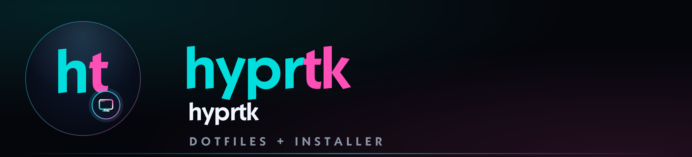

# hyprtk

### Hyprland Tinkerer ###

Linux is my desktop. I build dotfiles that turn any distribution into a themed Hyprland desktop — and tweak Hyprland until it sings.

<a href="https://github.com/hyprtk/dotfiles"></a>
<a href="https://github.com/hyprtk/hyprtk-bar-qt"></a>
<a href="https://github.com/hyprtk/hyprtk-file-manager"></a>
<a href="https://github.com/hyprtk/hyprtk-editor"></a>
<a href="https://github.com/hyprtk/hyprtk-term"></a>
<a href="https://github.com/hyprtk/hyprtk-calc"></a>
<a href="https://github.com/hyprtk/hyprtk-hyprland-config-manager"></a>
<a href="https://github.com/hyprtk/hyprtk-usb"></a>
<a href="https://github.com/hyprtk/Hyprtk-ISO-Creator"></a>


</div>

---

<div align="center">

## One suite. One desktop.

*Nine repositories, one installer, one mark, one palette — the desktop is the sum of them.*

</div>

<table>
<tr>
<td width="50%" valign="top">

### 🗂️ hyprtk dotfiles

**One installer. Any Linux distribution.**

A unified, `gum`-powered installer that deploys a complete, pywal16-themed Hyprland desktop on 18 distributions across six package-manager families — 18 package groups, 16 Lua modules and 60+ utility scripts, with a full **XFCE fallback** for safety. Every colour on screen is generated from your wallpaper.

[**Explore the installer →**](https://github.com/hyprtk/dotfiles)

</td>
<td width="50%" valign="top">

### 🪟 hyprtk-bar-qt

**The bar that is the whole desktop.**

A standalone Qt6 / QML (Quickshell) taskbar + desktop suite: task list, start menu, arc launcher, notification center, system tray, quick settings, system monitor, theme manager and free-floating desktop widgets — all themed live from your pywal16 palette.

[**Explore hyprtk-bar-qt →**](https://github.com/hyprtk/hyprtk-bar-qt)

</td>
</tr>
<tr>
<td width="50%" valign="top">

### 🗃️ hyprtk-fm

**The file manager.**

Qt6 / QML (Quickshell) with a Python backend: tabs, dual pane, breadcrumbs, thumbnails, previews, undo, trash and LAN share browsing. The default handler for folders, `Super + F` and the bar's **Files** link, with Thunar kept as a fallback.

[**Explore hyprtk-fm →**](https://github.com/hyprtk/hyprtk-file-manager)

</td>
<td width="50%" valign="top">

### 📝 hyprtk-editor

**The text editor.**

Qt Quick + Python: tabs with per-tab undo, session restore, autosaved crash-recovery drafts, Pygments highlighting for 600+ languages, regex search, a command palette, line operations and a minimap — syntax-coloured from the wallpaper palette.

[**Explore hyprtk-editor →**](https://github.com/hyprtk/hyprtk-editor)

</td>
</tr>
<tr>
<td width="50%" valign="top">

### ⚙️ config-manager

**The Hyprland settings GUI.**

Lua-first: it executes your real `hyprland.lua` module chain to read the effective configuration, then writes each change back to the file that owns it, with backups and verification. Opens standalone or as a layer-shell overlay from the bar's Settings.

[**Explore config-manager →**](https://github.com/hyprtk/hyprtk-hyprland-config-manager)

</td>
<td width="50%" valign="top">

### 💾 hyprtk-usb & ISO creator

**The install medium.**

`Hyprtk-ISO-Creator` builds the live Arch ISO with the desktop preinstalled (pywal theme, bar, file manager, editor, first-run seed); `hyprtk-usb` writes that image to a USB stick and can add a `hyprtk-persist` partition for the persistence boot entry.

[**ISO creator →**](https://github.com/hyprtk/Hyprtk-ISO-Creator) · [**usb →**](https://github.com/hyprtk/hyprtk-usb)

</td>
</tr>
<tr>
<td width="50%" valign="top">

### hyprtk-term

**The terminal.**

Qt Quick/QML over **libvterm**: tabs, a 10k-line scrollback with search, truecolor and the pywal palette, box drawing painted as geometry, and a few-hundred-millisecond start. Also the suite's `$TERMINAL`.

[**Explore hyprtk-term →**](https://github.com/hyprtk/hyprtk-term)

</td>
<td width="50%" valign="top">

### hyprtk-calc

**The calculator.**

Exact `Decimal` arithmetic behind a hand-written parser (no `eval`), so `0.1 + 0.2` is `0.3`; basic/scientific/programmer keypads, a shared history and a shell mode in the same binary.

[**Explore hyprtk-calc →**](https://github.com/hyprtk/hyprtk-calc)

</td>
</tr>
</table>

---

<div align="center">

## 01 · hyprtk dotfiles

*The installer behind the desktop.*

<!-- prettier-ignore -->
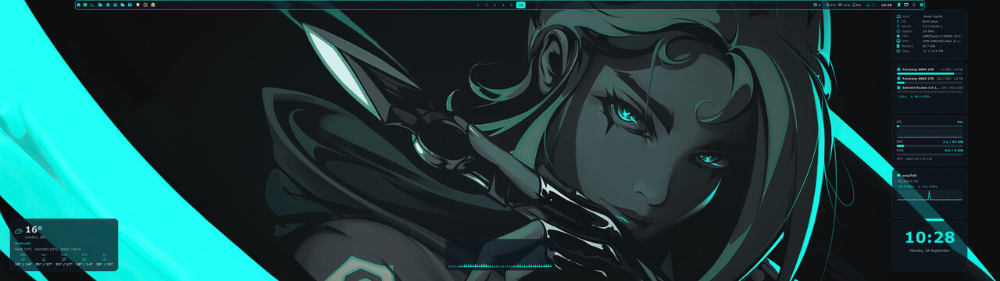

</div>

<div align="center">

### One installer, every Linux distribution

A single `1-install.sh` detects your distribution and lays down a matching, hand-tuned Hyprland desktop. From Arch to Alpine and Debian to openSUSE, the same command deploys to every supported system — and keeps them in sync.

</div>

<div align="center">
<table>
<tr>
<td align="center" width="33%"><b>🎨 pywal16 pipeline</b><br /><sub>One wallpaper drives every colour on the desktop</sub></td>
<td align="center" width="33%"><b>🧩 gum TUI installer</b><br /><sub>Auto-detects distro, 18 package groups, clean prompts</sub></td>
<td align="center" width="33%"><b>🖥️ XFCE fallback</b><br /><sub>A full desktop safety-net alongside Hyprland</sub></td>
</tr>
<tr>
<td align="center" width="33%"><b>🪟 hyprtk-bar-qt bundled</b><br /><sub>The desktop suite installs and autostarts with it</sub></td>
<td align="center" width="33%"><b>🧠 Modular Lua config</b><br /><sub>16 Lua modules for a clean, hackable Hyprland setup</sub></td>
<td align="center" width="33%"><b>⚡ NVIDIA & AMD ready</b><br /><sub>Dedicated configs, DRM and AMDGPU support</sub></td>
</tr>
<tr>
<td align="center" width="33%"><b>🛠️ 60+ utility scripts</b><br /><sub>Volume, brightness, recording, wallpaper and more</sub></td>
<td align="center" width="33%"><b>🖼️ Wallpaper tools</b><br /><sub>Random picker, wallpaper selector, film roll</sub></td>
<td align="center" width="33%"><b>🔒 Session & lock</b><br /><sub>swaylock blur, logout menu, SDDM/GRUB theming</sub></td>
</tr>
</table>
</div>

<br />

<div align="center"><h4>Showcase · the same desktop on every distro</h4></div>

<table>
<tr>
<td width="33%" align="center"><br /><b>Arch Linux</b></td>
<td width="33%" align="center">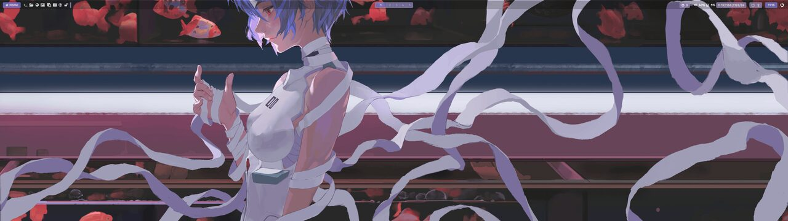<br /><b>EndeavourOS</b></td>
<td width="33%" align="center">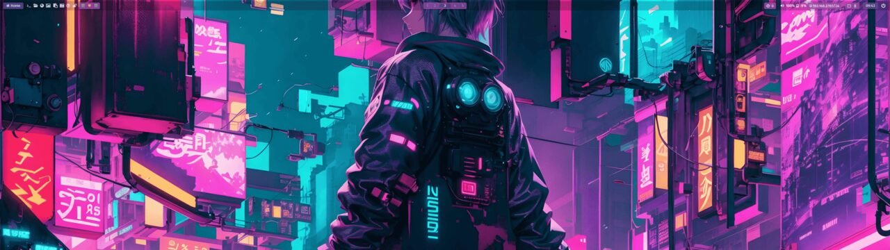<br /><b>Garuda</b></td>
</tr>
<tr>
<td width="33%" align="center">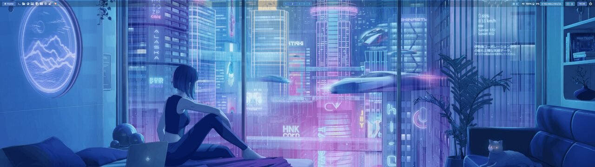<br /><b>CachyOS</b></td>
<td width="33%" align="center">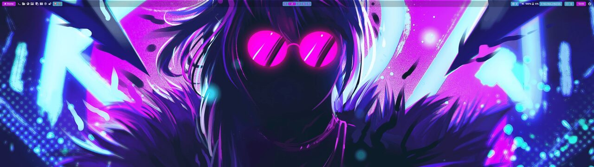<br /><b>Archcraft</b></td>
<td width="33%" align="center">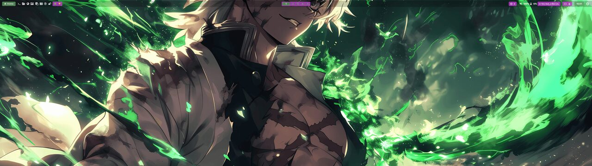<br /><b>ArchBANG</b></td>
</tr>
<tr>
<td width="33%" align="center">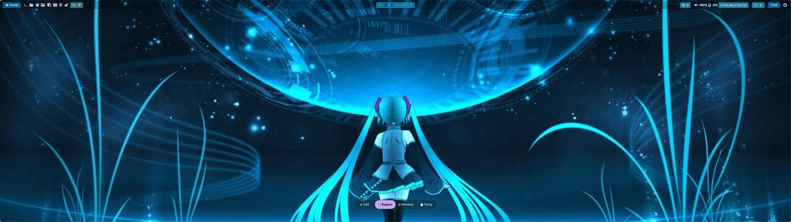<br /><b>Archman</b></td>
<td width="33%" align="center">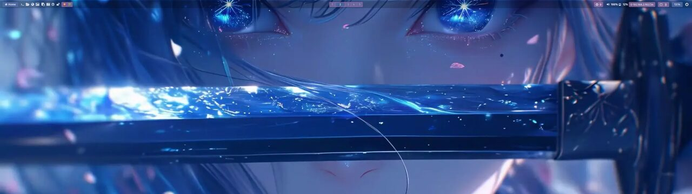<br /><b>BlueStar</b></td>
<td width="33%" align="center">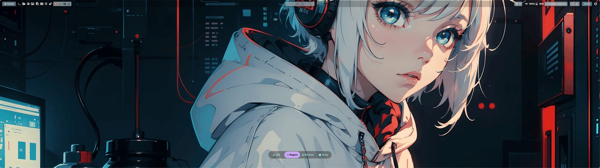<br /><b>Kiro</b> <sub>(ArcoLinux)</sub></td>
</tr>
<tr>
<td width="33%" align="center">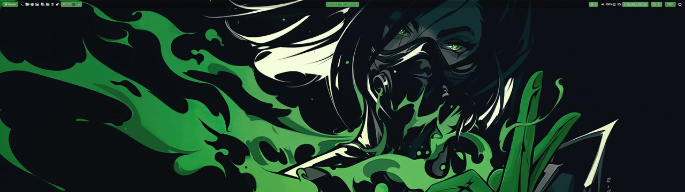<br /><b>Manjaro</b></td>
<td width="33%" align="center">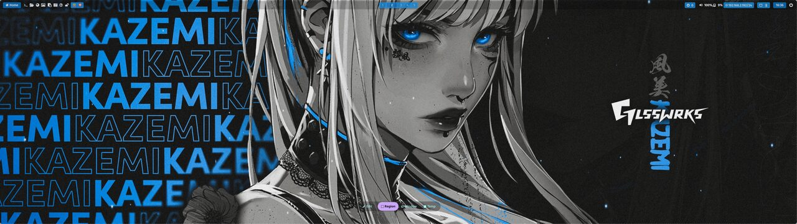<br /><b>RebornOS</b></td>
<td width="33%" align="center">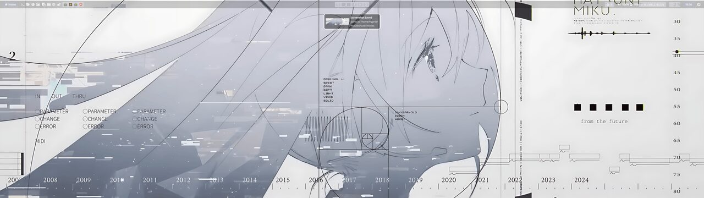<br /><b>my-dots</b> <sub>(personal)</sub></td>
</tr>
</table>

<br />

<div align="center">

### Install

```bash
git clone https://github.com/hyprtk/dotfiles.git ~/hyprtk
cd ~/hyprtk
sh ./1-install.sh
```

<a href="https://github.com/hyprtk/dotfiles"></a>

</div>

---

<div align="center">

## 02 · hyprtk-bar-qt

*The taskbar, menu, notifier and control center — in one Qt6 / QML suite.*

<!-- prettier-ignore -->
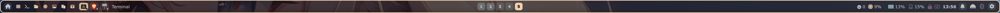

<sub>A fully modular taskbar: start button, quick links, task list, active window · centred workspaces · updates, system monitor, keyboard state, clock, notifications, tray and quick settings.</sub>

</div>

<div align="center">

### A complete desktop suite

hyprtk-bar-qt replaced a stack of separate tools — a bar, a launcher, a notification daemon and a theme manager — with one standalone app. It talks to Hyprland over IPC, renders with Qt6 / QML via Quickshell (layer-shell), and re-themes itself the instant your wallpaper changes.

</div>

<div align="center">
<table>
<tr>
<td align="center" width="33%"><b>🧩 Modular bar</b><br /><sub>Arrange, show/hide and reorder modules from settings</sub></td>
<td align="center" width="33%"><b>📋 Task list</b><br /><sub>Pinned + running apps, hover previews, focus / minimize / close</sub></td>
<td align="center" width="33%"><b>🔔 Notification center</b><br /><sub>Built-in <code>org.freedesktop.Notifications</code> daemon with toasts</sub></td>
</tr>
<tr>
<td align="center" width="33%"><b>🚀 Start menu</b><br /><sub>Four layouts: Whisker, Windows 7, Windows 11, Plasma</sub></td>
<td align="center" width="33%"><b>🌀 Arc menu</b><br /><sub>Radial Material-style app launcher overlay</sub></td>
<td align="center" width="33%"><b>🎛️ System tray</b><br /><sub>StatusNotifier + native DBusMenu menus</sub></td>
</tr>
<tr>
<td align="center" width="33%"><b>📊 System monitor</b><br /><sub>CPU, memory, disks, network, GPU and process manager</sub></td>
<td align="center" width="33%"><b>🎨 Theme manager</b><br /><sub>Wallpaper, pywal, bar themes, icons, SDDM & GRUB</sub></td>
<td align="center" width="33%"><b>⚙️ Quick settings</b><br /><sub>Wi-Fi, Bluetooth, volume + mic, brightness</sub></td>
</tr>
<tr>
<td align="center" width="33%"><b>🪟 Desktop widgets</b><br /><sub>Clock, weather, audio visualizer, disks, network, CPU/RAM, system info</sub></td>
<td align="center" width="33%"><b>⚙️ Full settings</b><br /><sub>Nine live pages: bar, fonts, themes, animations, menu, quicklinks, modules, widgets</sub></td>
<td align="center" width="33%"><b>📅 Calendar &amp; clock</b><br /><sub>Popup calendar and hover date on the clock</sub></td>
</tr>
</table>
</div>

<br />

<div align="center"><h4>Showcase · start menu</h4></div>

<table>
<tr>
<td width="25%" align="center">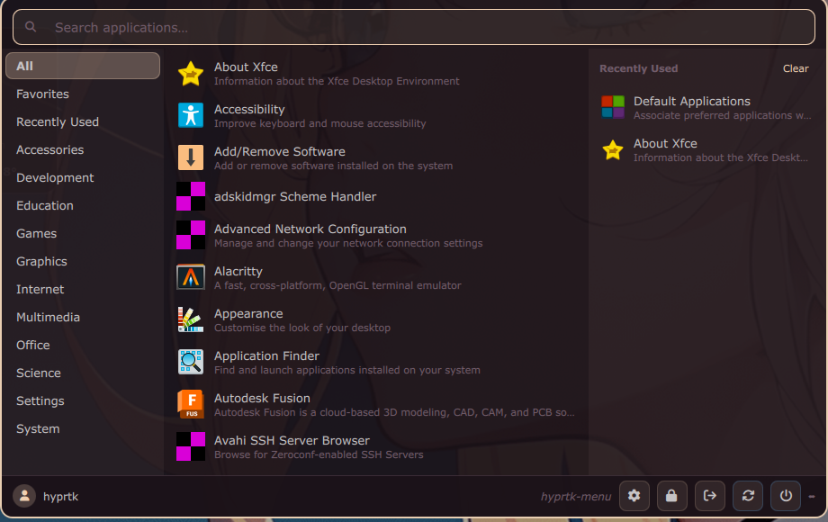<br /><b>Whisker</b></td>
<td width="25%" align="center">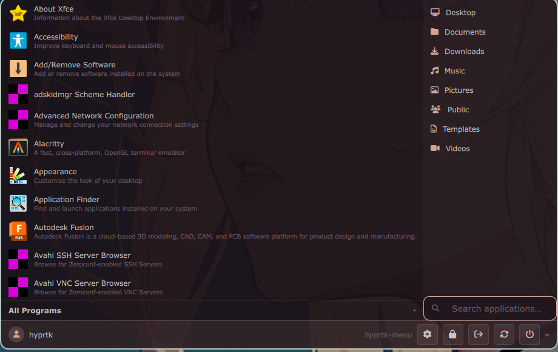<br /><b>Windows 7</b></td>
<td width="25%" align="center">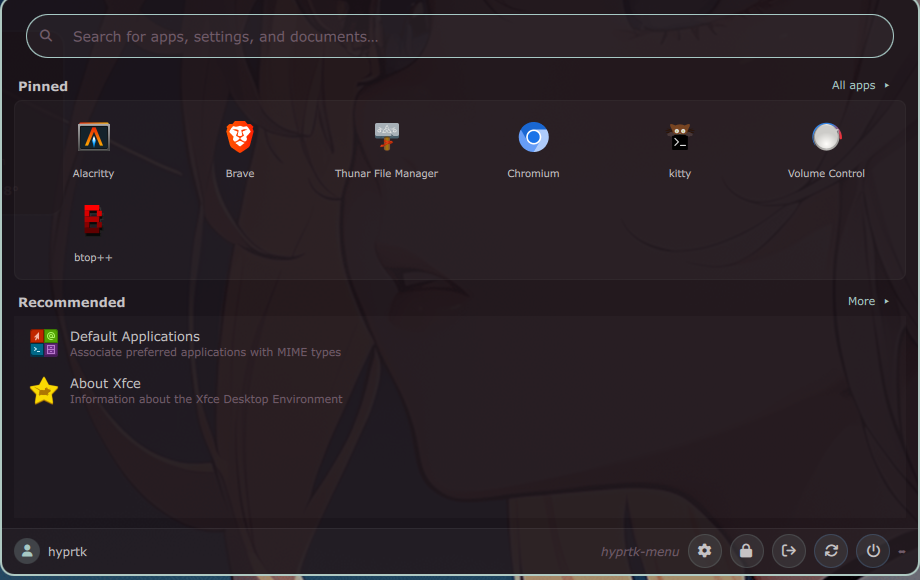<br /><b>Windows 11</b></td>
<td width="25%" align="center">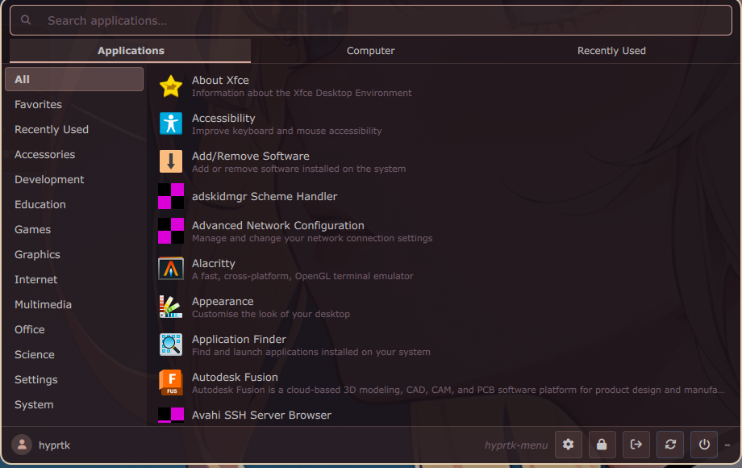<br /><b>Plasma</b></td>
</tr>
</table>

<div align="center"><h4>Showcase · launcher, quick settings &amp; calendar</h4></div>

<table>
<tr>
<td width="33%" align="center">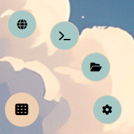<br /><b>Arc menu</b></td>
<td width="33%" align="center">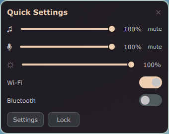<br /><b>Quick settings</b></td>
<td width="33%" align="center">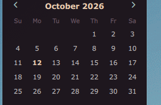<br /><b>Calendar</b></td>
</tr>
</table>

<div align="center"><h4>Showcase · settings (nine pages)</h4></div>

<table>
<tr>
<td width="33%" align="center">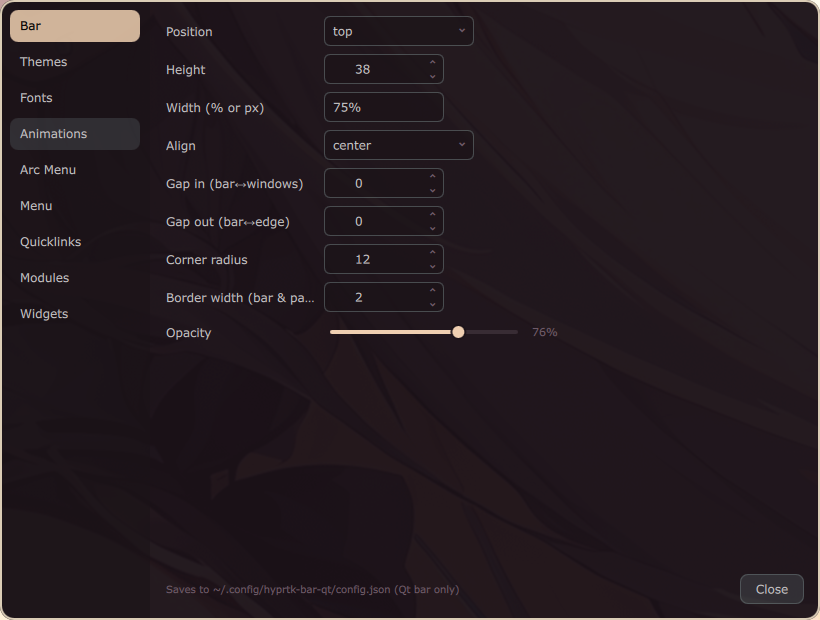<br /><b>Bar</b></td>
<td width="33%" align="center">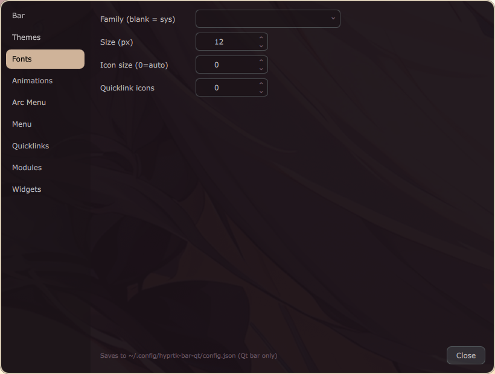<br /><b>Fonts</b></td>
<td width="33%" align="center">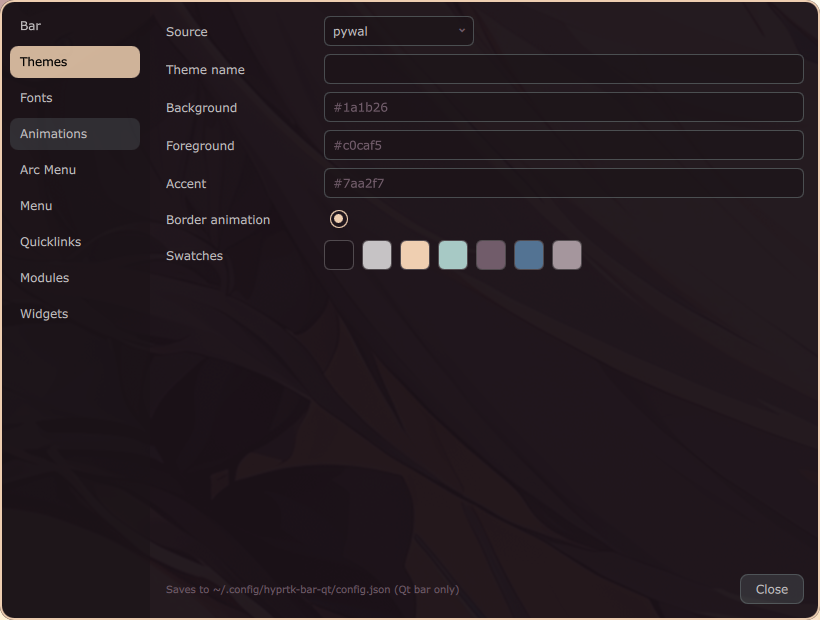<br /><b>Themes</b></td>
</tr>
<tr>
<td width="33%" align="center">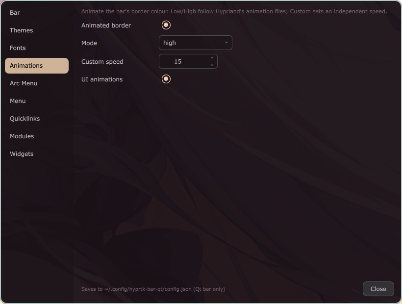<br /><b>Animations</b></td>
<td width="33%" align="center">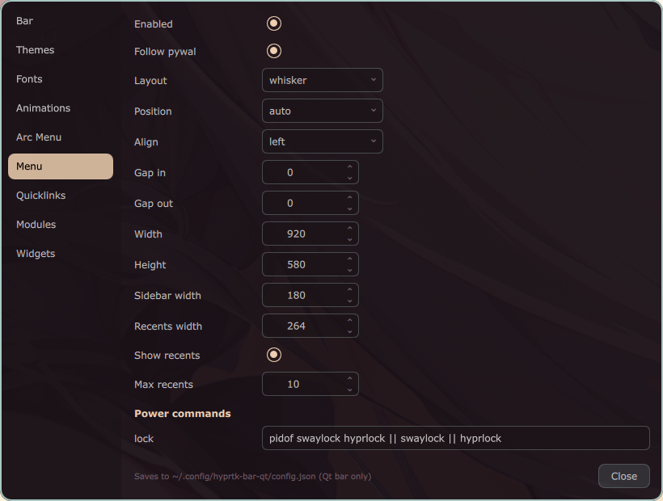<br /><b>Menu</b></td>
<td width="33%" align="center">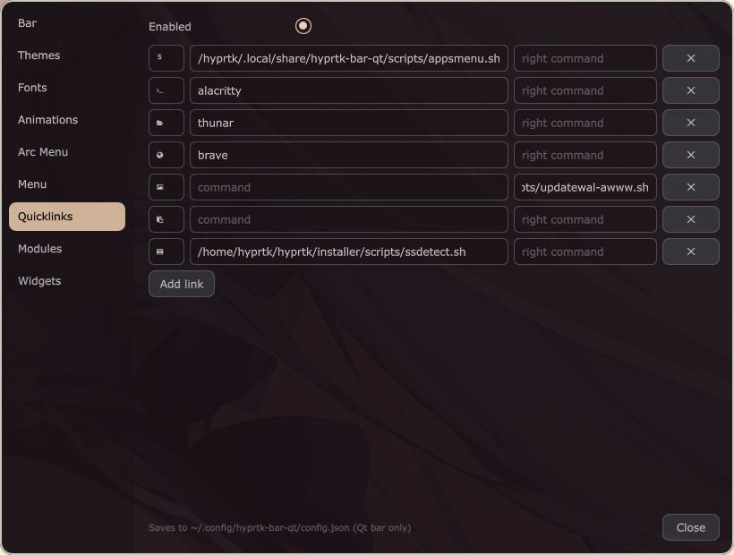<br /><b>Quicklinks</b></td>
</tr>
<tr>
<td width="33%" align="center">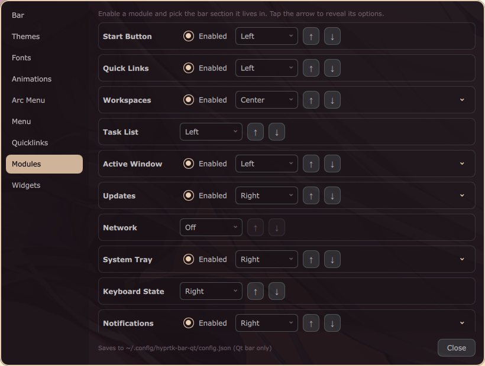<br /><b>Modules</b></td>
<td width="33%" align="center">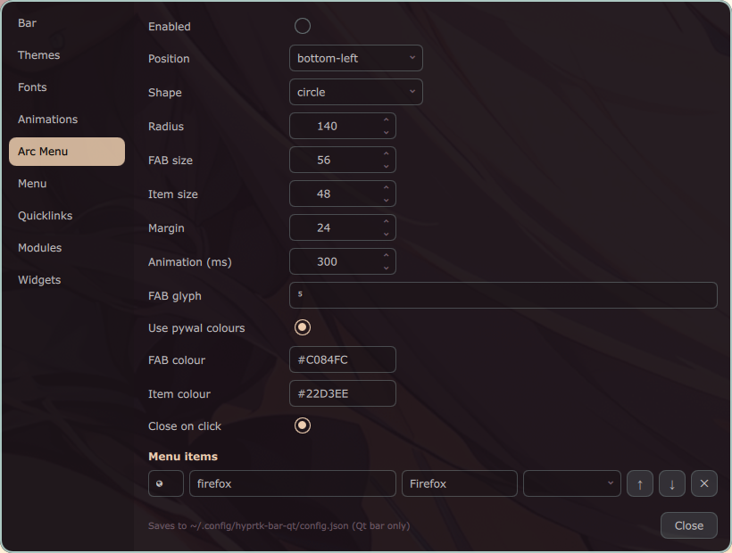<br /><b>Arc Menu</b></td>
<td width="33%" align="center">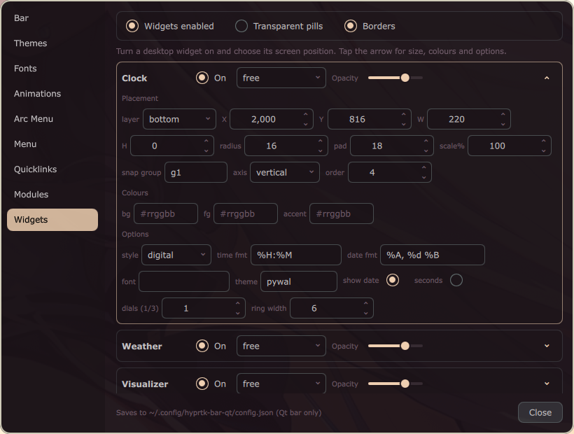<br /><b>Widgets</b></td>
</tr>
</table>

<div align="center"><h4>Showcase · desktop widgets</h4></div>

<table>
<tr>
<td width="25%" align="center">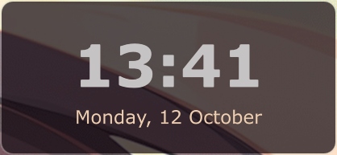<br /><b>Clock</b></td>
<td width="25%" align="center">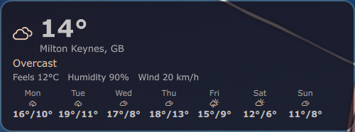<br /><b>Weather</b></td>
<td width="25%" align="center"><br /><b>Visualizer</b></td>
<td width="25%" align="center">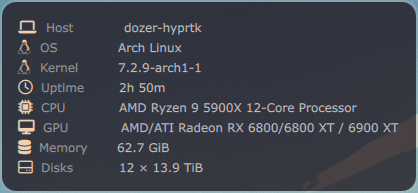<br /><b>System info</b></td>
</tr>
<tr>
<td width="25%" align="center">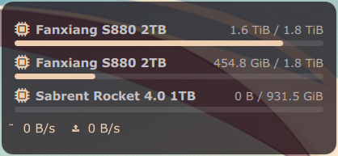<br /><b>Disks</b></td>
<td width="25%" align="center">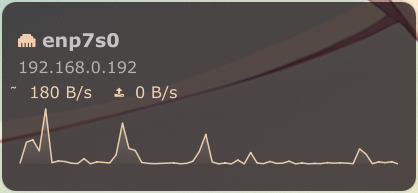<br /><b>Network</b></td>
<td width="25%" align="center">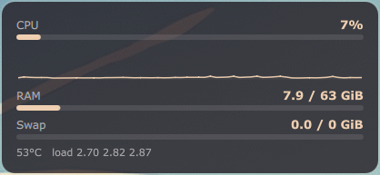<br /><b>CPU / RAM</b></td>
<td width="25%" align="center">&nbsp;</td>
</tr>
</table>

<div align="center"><h4>Showcase · monitors &amp; theming</h4></div>

<table>
<tr>
<td width="50%" align="center">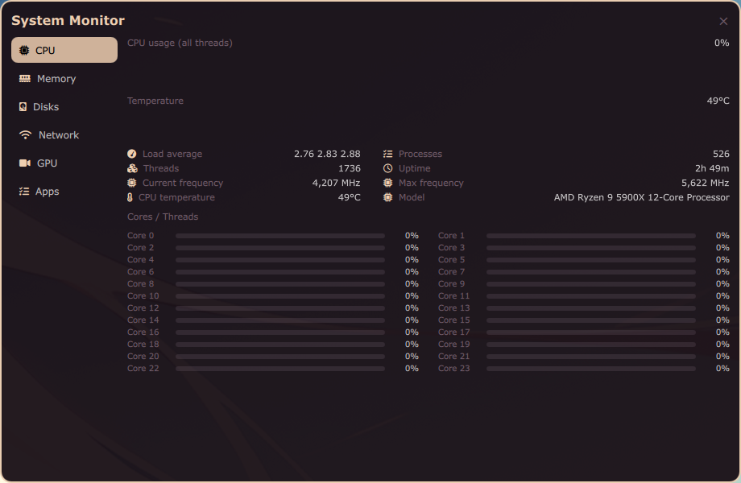<br /><b>System monitor</b></td>
<td width="50%" align="center">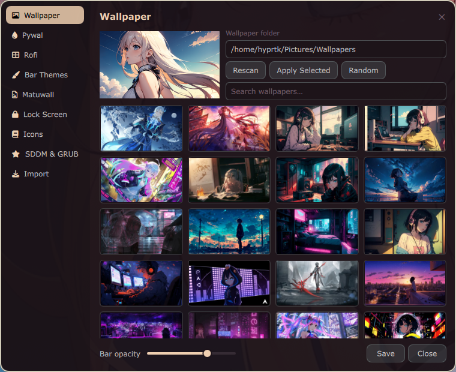<br /><b>Theme manager</b></td>
</tr>
</table>

<div align="center"><h4>Showcase · notifications</h4></div>

<table>
<tr>
<td width="50%" align="center">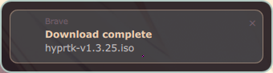<br /><b>Toast</b></td>
<td width="50%" align="center">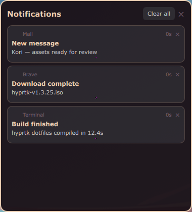<br /><b>Notification center</b></td>
</tr>
</table>

<br />

<div align="center">

### Install

```bash
git clone https://github.com/hyprtk/hyprtk-bar-qt
cd hyprtk-bar-qt
./install.sh
```

The installer detects your package manager, installs Quickshell / Qt6 and the
feature dependencies, bundles the bar themes and wallpapers, and registers the
bar with Hyprland's autostart. Run `./install.sh --dry-run` first if you want to
check requirements without changing anything.

<a href="https://github.com/hyprtk/hyprtk-bar-qt"></a>

</div>

---

<div align="center">

## Supported distributions

**18 distros · any Linux · custom-tuned per family**

`Arch` · `ArchBANG` · `Archcraft` · `Archman` · `BlueStar` · `CachyOS` · `EndeavourOS` · `Garuda` · `Kiro` · `Manjaro` · `RebornOS` · `Debian/Ubuntu` · `Fedora/RHEL` · `openSUSE` · `Void` · `Alpine` · `Gentoo` · `NixOS`

<sub>plus <a href="https://github.com/hyprtk/my-dots">my-dots</a>, a personal build</sub>

<br />

## Stack

<div>

<a href="https://hypr.land"></a>


</div>

</div>

---

<div align="center">

## Branding

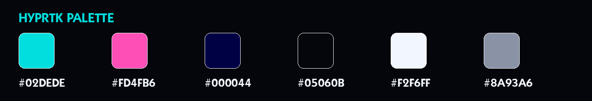

The suite is one mark, one palette and one typeface across every repository,
wiki and app icon. The mark is the **v09** direction: a near-black disc, a
gradient ring, the oversized `ht` anchor and the component glyph in a badge.
The wordmark is **KoblenzSerial Bold** — `hypr` in cyan, `tk` in magenta —
converted to outlines, so no font install is needed.

<sub>cyan <code>#02DEDE</code> · magenta <code>#FD4FB6</code> · navy <code>#000044</code> · ink <code>#05060B</code> · white <code>#F2F6FF</code> · muted <code>#8A93A6</code></sub>

<sub>Full guide: <a href="https://github.com/hyprtk/dotfiles#branding">dotfiles README → Branding</a></sub>

</div>

---

<div align="center">

## Hyprland update log

| Version | Notes |
|:-------:|:------|
| `0.55.4` | Conversion from `.conf` to `.lua` format for the Hyprland config |
| `0.55` | Removal of the Dwindle layout — dotfiles updated accordingly |

</div>

---

<div align="center">

## GitHub stats

<p>
  
  
</p>


<p>
  
</p>

<picture>
  <source media="(prefers-color-scheme: dark)" srcset="https://raw.githubusercontent.com/abozanona/abozanona/output/pacman-contribution-graph-dark.svg">
  <source media="(prefers-color-scheme: light)" srcset="https://raw.githubusercontent.com/abozanona/abozanona/output/pacman-contribution-graph.svg">
  
</picture>

</div>

---

<div align="center">

<a href="https://github.com/hyprtk/dotfiles">dotfiles</a> ·
<a href="https://github.com/hyprtk/hyprtk-bar-qt">hyprtk-bar-qt</a> ·
<a href="https://github.com/hyprtk/hyprtk-file-manager">hyprtk-fm</a> ·
<a href="https://github.com/hyprtk/hyprtk-editor">hyprtk-editor</a> ·
<a href="https://github.com/hyprtk/hyprtk-term">hyprtk-term</a> ·
<a href="https://github.com/hyprtk/hyprtk-calc">hyprtk-calc</a> ·
<a href="https://github.com/hyprtk/hyprtk-hyprland-config-manager">config-manager</a> ·
<a href="https://github.com/hyprtk/hyprtk-usb">hyprtk-usb</a> ·
<a href="https://github.com/hyprtk/Hyprtk-ISO-Creator">ISO creator</a> ·
<a href="https://hyprtk.github.io">site</a>

</div>
